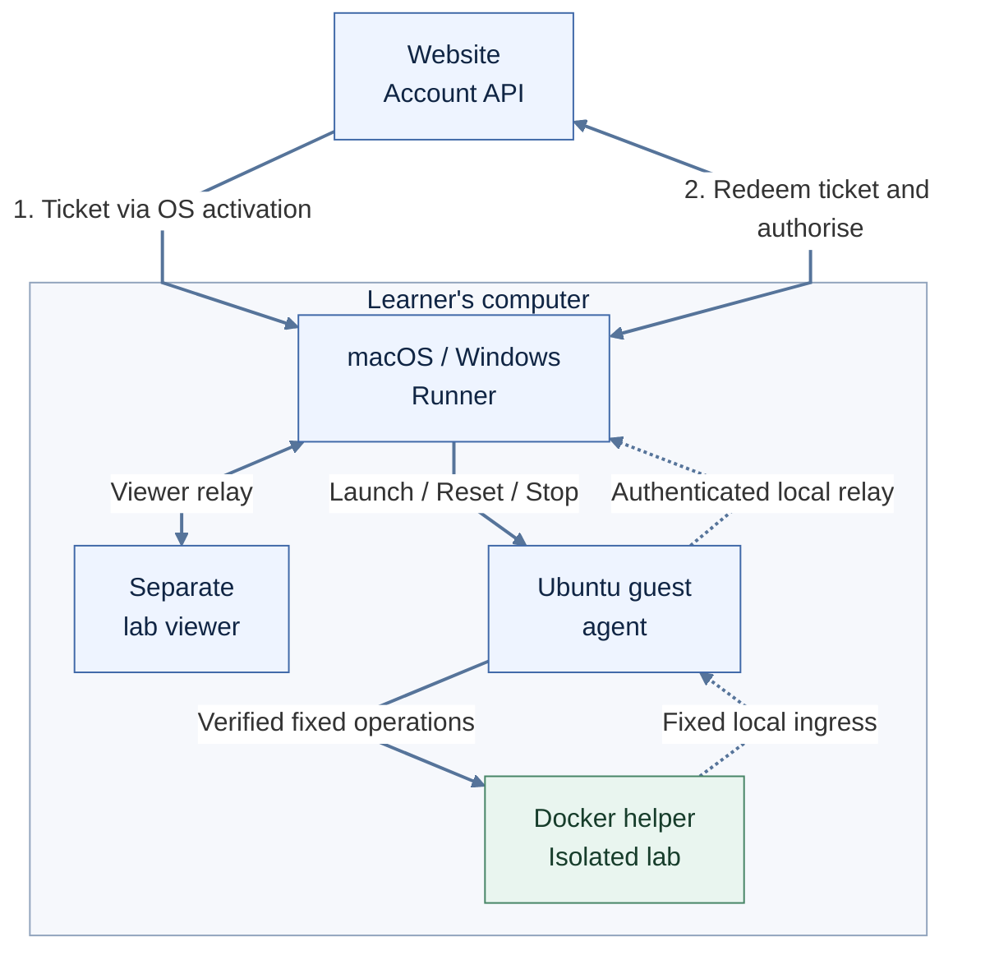
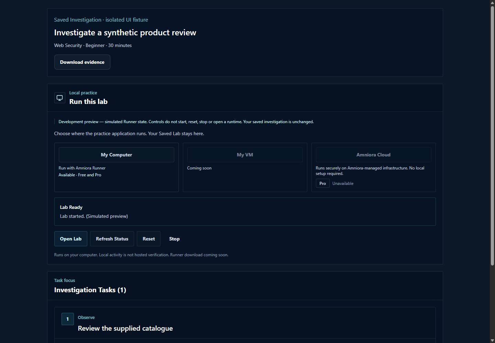

<p align="center">
  
</p>

<h1 align="center">Amniora</h1>

<p align="center">Cybersecurity investigations and local-first training labs</p>

<p align="center">
  <a href="docs/architecture.md">Architecture</a> ·
  <a href="docs/security-design.md">Security design</a> ·
  <a href="docs/included-components.md">Explore the source</a> ·
  <a href="docs/testing-and-limitations.md">Testing and limits</a>
</p>

**Licence: [MIT](LICENSE).** Third-party components retain their own terms.

Amniora is a cybersecurity learning project combining synthetic investigations, evidence-based tasks and isolated hands-on web security labs. I designed and implemented the web platform, investigation logic and local Runner work, with particular attention to the boundaries between a learner's account, their computer and a training environment.

**Active product development has been cancelled.** This sanitised portfolio edition preserves the website, macOS and Windows Runner source, offline tests and an account of the engineering work. The website runs locally with synthetic data and no Supabase account or private credentials. Native Runner source is included for compilation and review; there is no supported hosted service or packaged desktop release.

## At a glance

| Area | Scope |
| --- | --- |
| Purpose | Practise investigating synthetic evidence and working in authorised local labs |
| My role | Application design, implementation, security controls, testing and debugging |
| Original platform | Next.js and React, server-side authentication and data access, Linux evidence generation and OpenAI-backed guidance |
| Local execution | Shared protocol and Ubuntu guest-agent work, with macOS Swift and Windows C# implementations |
| Included here | Website with a local demo, both native Runner implementations, shared protocols and offline tests |
| Status | Product development cancelled; preserved as a portfolio project |

For a code-first review, start with [included components](docs/included-components.md). For the trust boundaries, read [security design](docs/security-design.md).

## What I built

### Web platform and investigation workspace

The web application brought investigation tasks, evidence, saved work, exports and grading feedback into one workspace. Server-side checks governed account access and ownership of saved investigations. The `website/` directory preserves the application source, including `app/`, and adds a local demonstration backed by synthetic fixtures. Production accounts, data and configuration are excluded.

### Linux investigation and evidence engine

The investigation engine constructed synthetic incident evidence and checked chronology, identities, task answerability and assessment inputs. Model-generated wording was constrained by evidence and narrative contracts. Its implementation is retained in the website source. The local demo uses deterministic examples, while the separate root tests exercise selected foundations and parsing rules.

### AI Tutor and task guidance

Tutor conversations and task assistance used the OpenAI Responses API through server-side routes with access, input and usage checks. The Tutor also checked conversation ownership and content-sharing consent. Guidance supported explanations, hints, commands and quizzes. It was not an autonomous lab executor. The live provider integration is documented rather than enabled here.

### Local-first My VM execution

The website coordinated account permissions and short-lived commands. A paired Runner bridged those commands to an Ubuntu guest, where package verification and a narrow helper constrained lab operations. Runtime and generation checks helped reject stale commands and keep Reset, Stop and viewer state aligned.

### macOS and Windows Runner work

Both native implementations are included under `runner/`. They adapt shared protocols to different desktop activation, identity storage and viewer APIs. The later Runner snapshot and the primary website snapshot remain separate, with their provenance and validation limits documented. The local website demo does not pair with a native Runner or provision a VM.

### Security controls and testing

The work included one-use activation tickets, PKCE pairing, device proofs, signed packages, replay checks, fixed-purpose guest operations, Docker restrictions and viewer policies. Regression tests exercised failure paths as well as successful lifecycle transitions. This was development testing, not an independent security audit or certification.

## How it works

In the original product design, a learner opens an investigation and its tasks on the website, pairs a Runner and starts a lab in an Ubuntu guest. The guest runs the isolated Docker lab. A separate viewer opens the local lab, while Reset creates a fresh generation and Stop cleans up the active runtime. The portfolio's local website uses synthetic data to demonstrate the workspace without starting those services.

## Architecture



The diagram describes the original local-first design and groups the website and account API for readability. Solid arrows show control and viewer connections; dotted arrows trace lab responses over the local relay. Lab traffic stays on the learner's computer. The portfolio's synthetic website does not start this native execution path.

1. The website requests an **opaque one-use activation ticket** from the account service.
2. The operating system opens the paired Runner with that ticket.
3. Runner redeems the ticket and proves its device identity. The service returns the authorised command and, for Launch, a **separately signed lab package**.
4. The guest verifies package authority before the narrow helper performs fixed operations. Reset changes the runtime generation; Stop removes its lab resources.

The viewer sends bounded requests through Runner, the authenticated guest relay and fixed local ingress. [Architecture details](docs/architecture.md) explain the trust boundaries.

## Security decisions

- Keep permissions server-authoritative; a browser request alone cannot grant access.
- Bind commands to the relevant account, device, build, runtime and generation, with checks appropriate to each operation.
- Use PKCE for pairing and device identity proofs for subsequent protocol operations.
- Constrain the privileged helper to named operations rather than expose a generic shell interface.
- Enforce one active lab and keep viewer reuse, Reset and Stop tied to runtime identity and generation.
- Treat a learner-controlled machine as an untrusted source of completion evidence.

See [security design](docs/security-design.md) for the implementation details and trade-offs.

## Cross-platform validation

| Platform | Implementation evidence | Live validation evidence | Remaining boundary |
| --- | --- | --- | --- |
| macOS ARM64 host / Ubuntu ARM64 guest | Native Runner, identity, guest bridge and viewer work | Historical reports describe launch, viewer, Reset and Stop exercises | Not rerun on a Mac for this export; network-layer assurance remained qualified |
| Windows x64 host / Ubuntu AMD64 guest | W1/W2 and continuity source, activation and VM runtime work | W1 native activation, identity and viewer reports used disposable guest fixtures; later VM source and harnesses are present | Full W2/continuity certification is not established by the retained evidence reviewed here |
| Linux desktop Runner / Windows ARM64 | No supported distribution claimed | No certification claimed | Outside this edition's validated scope |

Offline tests of exported components are a separate result from native application and real-VM testing. See [testing and limitations](docs/testing-and-limitations.md).

## Selected development history

The project evolved from investigation workspaces and synthetic Linux evidence into structured assessment, local execution protocols and native Runner work. Later changes addressed desktop activation, stale status, viewer reuse and recovery across interrupted commands. macOS, Windows and shared continuity work reached different validation states.

The [development history](docs/development-history.md) records the goals, decisions, evidence and remaining limitations without publishing private development history.

## Screenshots

Reviewed captures from the original development work are collected in the [screenshot gallery](docs/screenshots.md). They use synthetic examples and preserve the original pixels. Historical beta labels and simulated runtime states describe the captures, not the current project status.

<a href="docs/screenshots.md">
  
</a>

*Saved-investigation interface test with simulated Runner state. See the gallery for the homepage tour and Linux evidence export.*

## Engineering lessons

I learned to separate presence from readiness. A Runner being reachable does not prove that its VM, guest agent or active lab is ready, and an old status response should not suggest reinstalling a working VM.

Desktop URI activation also needed lifecycle thinking: cold starts, repeated links and already-running processes can follow different paths. Treating Reset and Stop as generation-aware operations made stale commands and viewer state easier to reason about.

Signing formats and test fixtures required equal care. Canonical representations, package expiry and alignment between test artefacts and trusted public keys can decide whether a sound protocol works in practice.

Local execution shifts workload away from hosted infrastructure, but it creates another trust boundary. Successful execution on a learner's computer is not universal proof of trustworthy completion.

## Repository contents

| Location | Contents |
| --- | --- |
| `website/` | Next.js application, investigation engine, product guidance and local synthetic demo |
| `runner/` | macOS Swift apps, Windows C# projects and shared local-first implementation |
| `lib/`, `tests/` | Standalone protocol, runtime, viewer and Linux-foundation tests |
| `excerpts/` | Focused native modules used by the review and policy tests |
| `docs/`, `assets/` | Engineering documentation, reviewed screenshots and original branding |

[Included components](docs/included-components.md) explains the source snapshots and runnable boundaries.

Production configuration, credentials, personal data, private history, deployment workflows, installers, VM images and operational logs are excluded. Local hosting uses the synthetic demo, without production authentication, cloud execution or AI-provider calls.

## Running the included components

Use Node.js 22 or newer; this edition was checked with Node.js 24.18.0. To run the website locally, start from the repository root:

```sh
cd website
npm ci --ignore-scripts --no-audit --no-fund
npm run dev
```

Open the loopback address printed by the server. No Supabase setup, environment file or API key is required. [Website instructions](website/README.md) describe the synthetic workspace and its limits.

To run the separate offline engineering tests, open another terminal at the repository root:

```sh
npm ci --ignore-scripts --no-audit --no-fund
npm test
npm run typecheck
```

These commands passed against the sanitised selection. The six offline suites cover Linux foundations, ticket/PKCE contracts, signed packages, the fake-Docker helper, runtime lifecycle and viewer policy. Installation downloads pinned development dependencies; the test harness blocks external network requests and child-process execution within its suites.

For the separate Windows policy checks, install the .NET 8 SDK and run:

```sh
dotnet run --project tests/windows-policy/WindowsPolicyTests.csproj
```

This passed 24 checks with .NET SDK 8.0.425. It tests URI, state, diagnostics and viewer policy using selected C# source; it does not launch an installed Runner, access DPAPI identities or start a VM.

The portfolio harness uses synthetic fixtures and local test doubles; it does not require the live service, real environment files or a production account. [Included components](docs/included-components.md) explains the test coverage and source boundaries.

The [Runner instructions](runner/README.md) describe shared-code compilation and native build boundaries. The Windows Runner, Viewer and IdentityHelper projects compiled on the preparation host. They were not launched or installed, and the macOS apps were not compiled on this Windows machine.

## Limitations and project status

Local completion is not universal trusted attestation. Viewer restrictions do not establish immunity to browser or operating-system exploits. macOS network-layer assurance remained qualified, while Windows identity and distribution hardening remained incomplete. Public installer signing and update distribution were not fully released, and continuity testing and promotion did not all reach the same final state.

My Computer and Amniora Cloud are not presented as finished products. This portfolio makes no claim about the current availability of the historical domain. Active product development has been cancelled.

Original work is licensed under the [MIT License](LICENSE). See [SECURITY.md](SECURITY.md) for authorised local use and safe reporting, and [third-party notices](THIRD_PARTY_NOTICES.md) for retained terms.

## Author

[Hamse Guled](https://github.com/HamseGuledProjects)
