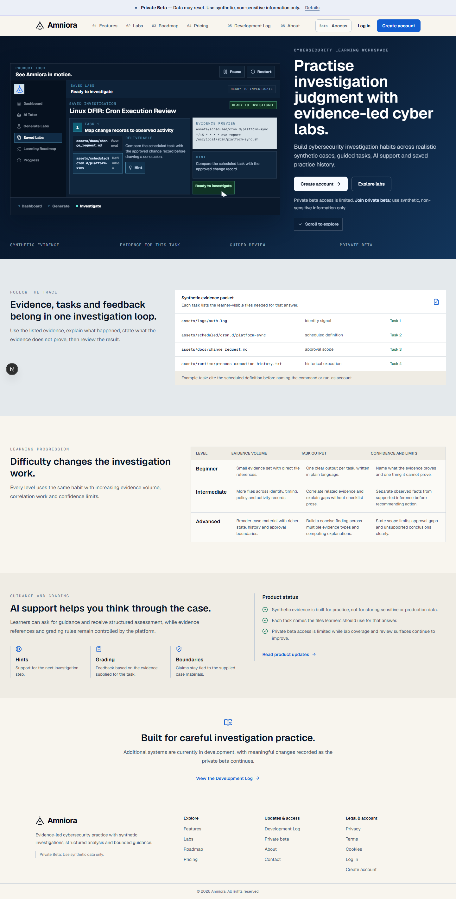
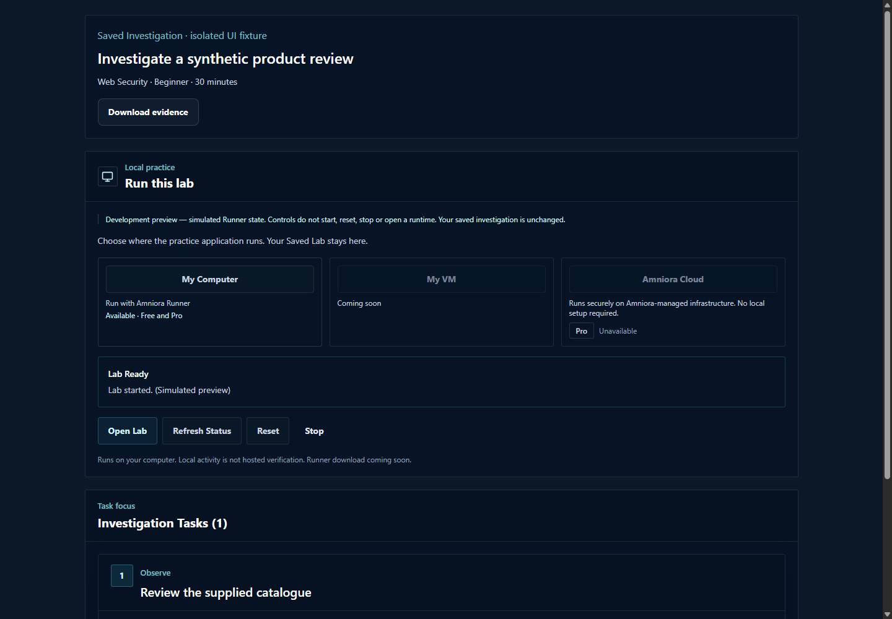
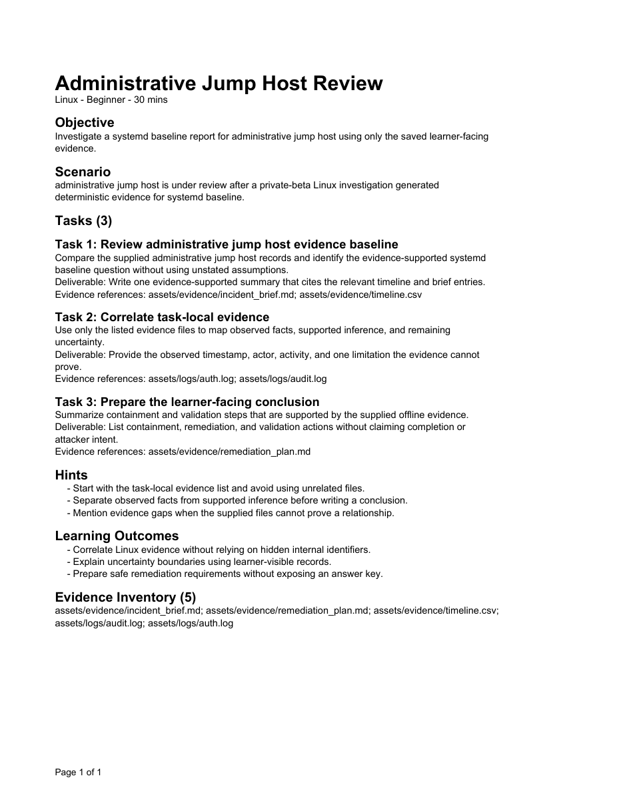

# Screenshots

These are retained captures from the original development work. Each image was inspected for private information and unnecessary metadata. They are not generated replacements. Historical interface labels remain visible; active product development has been cancelled.

## Homepage and investigation tour

This saved homepage capture shows the implemented public website and its synthetic product tour, including investigation tasks and evidence selection. It is a demonstration interface, not a recording of a learner session. Historical beta and release wording belongs to the captured page.

## Saved investigation and runtime controls

This capture comes from an isolated saved-investigation browser test. The interface explicitly identifies the Runner state as simulated. It illustrates the task workspace and runtime-control presentation, without claiming that a VM or hosted lab was running.

## Linux investigation export

This is a rendered page from a synthetic PDF-export test. It shows the objective, evidence-scoped tasks, hints and evidence inventory produced by the export path. It is a document fixture, not a live investigation screenshot.

## Scope

The images contain synthetic case material. Original image pixels were retained; no private details were covered with removable overlays. No reviewed native macOS or Windows Runner screenshot is included. Platform behaviour is described separately in [testing and limitations](testing-and-limitations.md).
